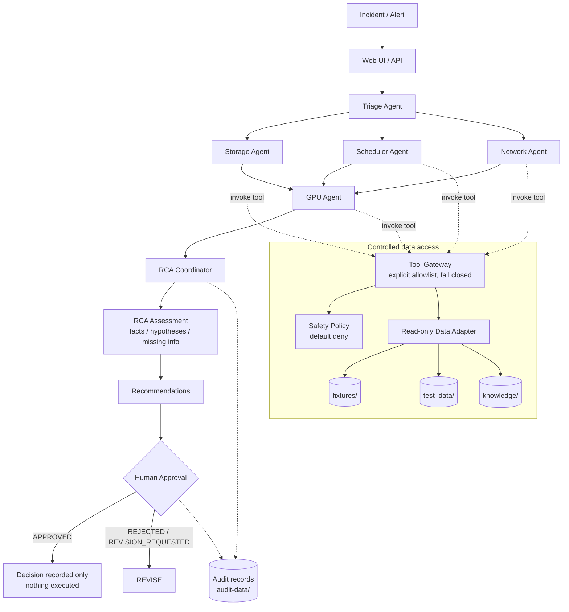

# Architecture

## Logical flow



## Deployment (target, Iteration 6)

```
Rocky Linux 10
 └─ Podman (rootless)
     └─ hpc-ai-agent container (non-root)
         ├─ API, agent workflow (triage, specialists, RCA coordinator)
         ├─ Tool Gateway, knowledge layer, human approval, audit logger
         └─ test data adapter
     volumes: knowledge/ (ro), test_data/ (ro), audit-data/ (rw)
```

## Components implemented in Iteration 1

| Component | Module |
|---|---|
| Incident model | `models/incident.py` |
| AgentDiagnosis, RCAResult, Evidence, ProbableCause, RecommendedAction | `models/diagnosis.py` |
| ApprovalRecord, ApprovalStatus | `models/approval.py` |
| AuditRecord | `models/audit.py` |
| Approval state machine | `safety/approval.py` |
| Safety policy (default deny) | `safety/policy.py` |
| Credential-like content scanner | `safety/secrets.py` |
| Read-only data adapter | `data_adapter.py` |
| Tool Gateway + read-only domain tools | `tools/gateway.py`, `tools/*_tools.py` |

## Design notes

- **Evidence traceability**: every `Evidence` has a `kind` (incident report, tool result or
  knowledge) and a `source` reference. Tool results carry the relative path of the saved
  data they came from.
- **No invented data**: if a tool has no saved data, it returns `no_data` with `data=None`.
- **LLM provider abstraction** (Iteration 2+): domain logic depends only on the models and the
  gateway, not on a vendor SDK. The provider is selected by `MODEL_PROVIDER` / `MODEL_NAME` /
  `MODEL_ENDPOINT`.
- **Knowledge layer** (Iteration 4): `search_incident_history`, `search_sop` and `search_manual`
  will start as simple file search. A future RAG backend can replace them behind the same interface.
