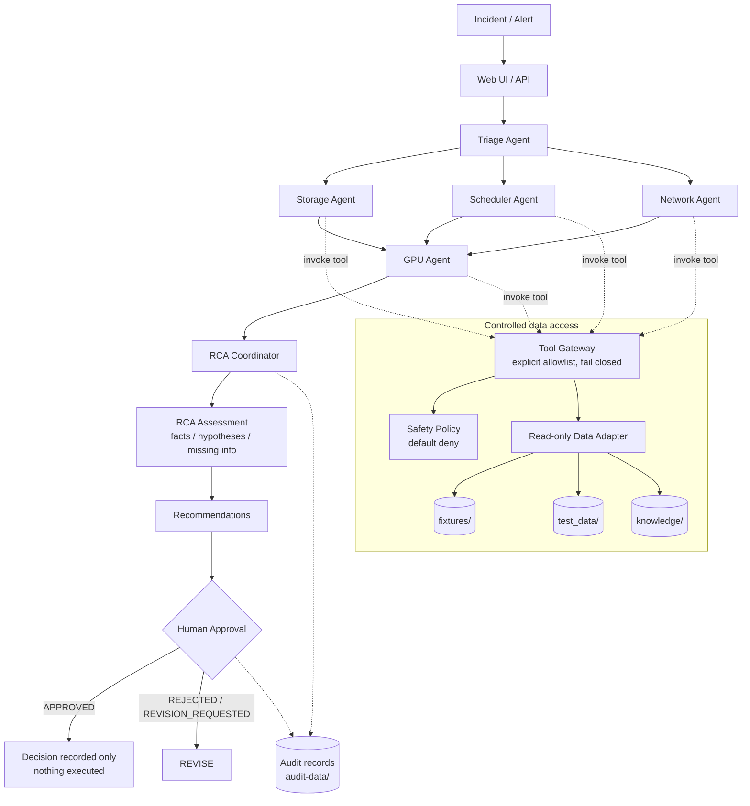
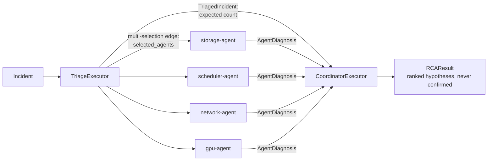
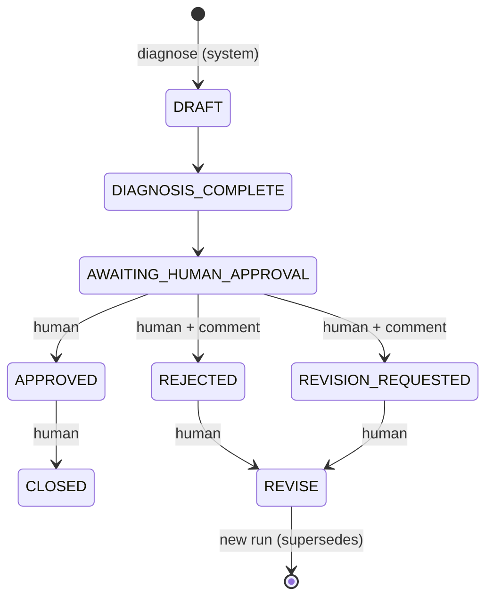
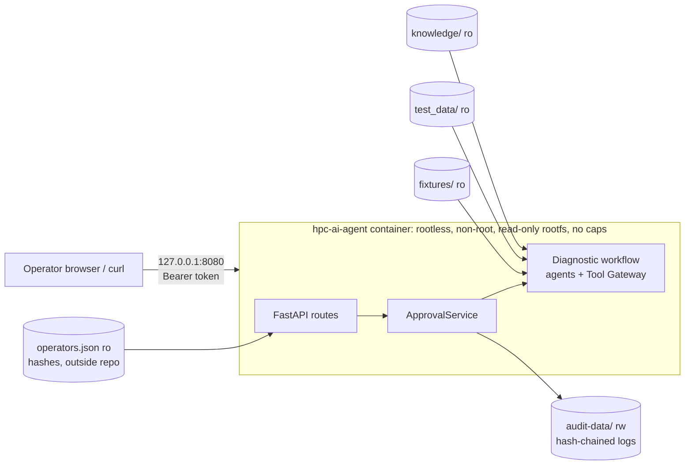

# Architecture

## Logical flow



## Deployment (target, Iteration 6)

```
Rocky Linux 10
 └─ Podman (rootless)
     └─ hpc-ai-agent container (non-root)
         ├─ API, agent workflow (triage, specialists, RCA coordinator)
         ├─ Tool Gateway, knowledge layer, human approval, audit logger
         └─ test data adapter
     volumes: knowledge/ (ro), test_data/ (ro), audit-data/ (rw)
```

## Components implemented in Iteration 1

| Component | Module |
|---|---|
| Incident model | `models/incident.py` |
| AgentDiagnosis, RCAResult, Evidence, ProbableCause, RecommendedAction | `models/diagnosis.py` |
| ApprovalRecord, ApprovalStatus | `models/approval.py` |
| AuditRecord | `models/audit.py` |
| Approval state machine | `safety/approval.py` |
| Safety policy (default deny) | `safety/policy.py` |
| Credential-like content scanner | `safety/secrets.py` |
| Read-only data adapter | `data_adapter.py` |
| Tool Gateway + read-only domain tools | `tools/gateway.py`, `tools/*_tools.py` |

## Components added in Iteration 2

| Component | Module |
|---|---|
| Triage Agent | `agents/triage.py` |
| Storage Agent | `agents/storage.py` |
| Scheduler Agent | `agents/scheduler.py` |
| Evidence helpers, domain keyword signals | `agents/evidence.py` |
| Per-agent ScopedGateway (scope ∩ allowlist, records every call) | `tools/gateway.py` |
| Agent tool scopes | `config/agents.yaml`, `config.py` |
| TriageResult, DiagnosticRun | `models/triage.py`, `models/run.py` |
| Agent Framework workflow + text report | `workflows/diagnostic_workflow.py` |

## Components added in Iteration 3

| Component | Module |
|---|---|
| Network Agent | `agents/network.py` |
| GPU Agent (XID table, telemetry checks; no live DCGM) | `agents/gpu.py` |
| RCA Coordinator | `agents/coordinator.py` |
| Structured causes on `AgentDiagnosis` (`ProbableCause` with domain, support, conflicts) and `affected_components` | `models/diagnosis.py` |
| `RCAResult.cross_domain_relationships`; `DiagnosticRun.rca` | `models/diagnosis.py`, `models/run.py` |

### Workflow (Iteration 3)



### RCA Coordinator rules

- **Ranking**: open hypotheses are sorted by confidence. Ties keep triage order and are
  reported as ties in the summary.
- **Ruled out**: causes that specialists ruled out are kept, with the conflicting evidence
  they cite.
- **Classification**: `multi-domain` when tool-backed hypotheses span two or more domains;
  otherwise the triage classification.
- **Relationships**: an incident item cited by two or more domains, or a component (for
  example `node:…`) implicated by two or more domains.
- **Cross-domain checks**: when a node is implicated, checks are recommended for any storage,
  network or GPU domain that wasn't examined.
- **Never confirms.** Specialists can't confirm (enforced by the model), and the coordinator
  doesn't. A static test checks that no agent or workflow code sets `CONFIRMED`.

## Components added in Iteration 5

| Component | Module |
|---|---|
| `ApprovalRequest`, `ActionForReview`; `AuditRecord.operator`; `DiagnosticRun.supersedes` | `models/approval.py`, `models/audit.py`, `models/run.py` |
| Approval service, run store, review rendering | `workflows/approval_workflow.py` |
| Hash-chained append-only log | `logging/audit_logger.py` |
| Operator CLI (`review`, `approve`, `reject`, `request-revision`, `revise`, `close`, `history`, `verify-audit`) | `main.py` |



## Components added in Iteration 6

| Component | Module |
|---|---|
| HTTP API (FastAPI) | `api/routes.py` |
| Review page (static HTML/CSS/JS, no framework) | `api/static/` |
| Operator token authentication | `safety/operators.py` |
| Container image | `containers/Containerfile`, `containers/requirements.lock`, `.containerignore` |
| Deployment and verification scripts | `scripts/podman_run.sh`, `scripts/container_smoke_test.sh`, `scripts/lock_requirements.sh`, `scripts/run_api.sh` |

### Deployed form



## Design notes

- **Evidence traceability**: every `Evidence` has a `kind` (incident report, tool result or
  knowledge) and a `source` reference. Tool results carry the relative path of the saved
  data they came from.
- **No invented data**: if a tool has no saved data, it returns `no_data` with `data=None`.
- **Framework boundary**: agents are plain Python classes. Microsoft Agent Framework
  (`agent-framework-core`) is used only in `workflows/` to route messages between executors.
  An exception in any agent aborts the run (fail closed).
- **LLM provider abstraction** (not yet implemented): no LLM is called yet. When one
  is added, it should only *phrase* findings from the evidence the deterministic agents
  produce, never add facts. It should get no tool access beyond the agent's ScopedGateway,
  and its output should be validated through the same Pydantic models. The provider will be
  selected by `MODEL_PROVIDER` / `MODEL_NAME` / `MODEL_ENDPOINT`.
- **Knowledge layer**: `search_incident_history`, `search_sop` and `search_manual` are
  implemented by `KeywordKnowledgeBase` (`tools/knowledge_tools.py`).
  - It scores documents by distinct matching terms, with title terms counting double, and
    ignores identifiers such as node names.
  - It needs at least two matching terms, and keeps only hits scoring at least half of the
    best one.
  - The `KnowledgeBase` protocol lets a RAG backend replace it without changing callers.

## Components added in Iteration 4

| Component | Module |
|---|---|
| Synthetic SOPs, manuals, past incidents | `knowledge/` |
| Knowledge tools and `KnowledgeBase` interface | `tools/knowledge_tools.py` |
| Read-only Markdown access (`read_text`, `list_files`) | `data_adapter.py` |
| `query` argument type, per-run `CallBudget` | `tools/gateway.py` |
| Reference lookup from an agent's own findings | `agents/evidence.py` (`gather_references`) |
| `Evidence.observed_at`; `references` on diagnoses and RCA; `RCAResult.timeline` | `models/diagnosis.py` |
| Temporal correlation | `agents/coordinator.py` |
| Run-level invariant checks | `safety/guards.py` |

### Temporal correlation

When an observation in the saved data has a timestamp, the agent records it as `observed_at`.
The coordinator then:

- builds a timeline;
- reports observations within ±30 minutes of the incident as concurrent, and flags those
  more than 30 minutes before it as of uncertain relevance;
- flags observations more than 30 minutes after the incident: they can't have caused it and
  may not reflect conditions at the time of failure;
- halves the confidence of a hypothesis when all of its tool evidence comes from after the
  window.

If the incident has no timestamp, no temporal claims are made.
