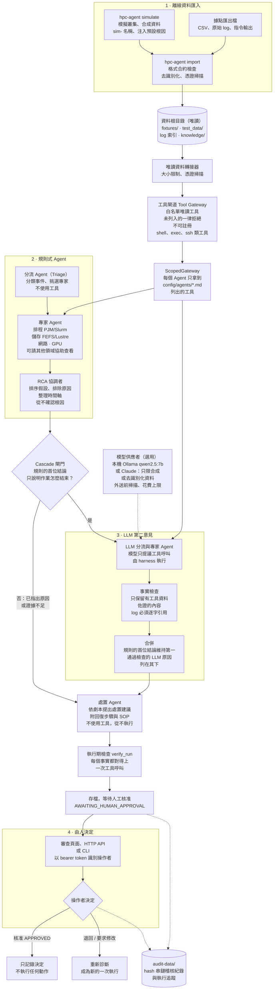

# 系統架構（繁體中文）

**AI 提出建議，工具提供證據，由人決定。** 英文版見 [README.md](../README.md#architecture)。

## 說明

- **資料只能從唯讀路徑進來。** Agent 讀資料只能經過唯讀資料轉接器和白名單工具閘道，每個 Agent 的
  ScopedGateway 再把範圍縮小到它自己的工具。系統不連線到叢集，也不執行任何指令。
- **規則先答。** 規則式 Agent 以 Microsoft Agent Framework 工作流程執行：分流 Agent 挑選專家，專家用唯讀工具
  收集證據，RCA 協調者排序假設，但從不確認根因。
- **LLM 只在規則說不出原因時才補充。** 規則的首位結論如果只說明作業怎麼結束（例如逾時、被終止、非零結束碼），
  cascade 閘門才讓 LLM Agent 分析。模型只能提議工具呼叫，提出的原因必須通過事實檢查，log 必須逐字引用。
  合併時規則的答案維持第一，LLM 的原因列在下方作為第二意見。規則因證據不足而不下結論時，LLM 不會介入。
- **處置只是建議。** 處置 Agent 沒有工具，只依劇本提出建議；`verify_run` 檢查每個事實都對得上工具呼叫後才存檔。
- **由人決定。** 操作者在審查頁面、HTTP API 或 CLI 做決定；核准只記錄決定，不執行任何動作。每一步都寫進
  hash 串鏈的稽核紀錄。

`hpc-agent diagnose` 和審查頁面執行規則式 Agent，或以 `HPC_AGENT_REASONING=llm` 改由 LLM Agent 執行；cascade
（閘門、LLM 第二意見、合併）用於 `hpc-agent evaluate --reasoning cascade` 和
`hpc-agent drill-prepare --reasoning cascade`。圖中虛線表示設定或紀錄，不是資料流向。
